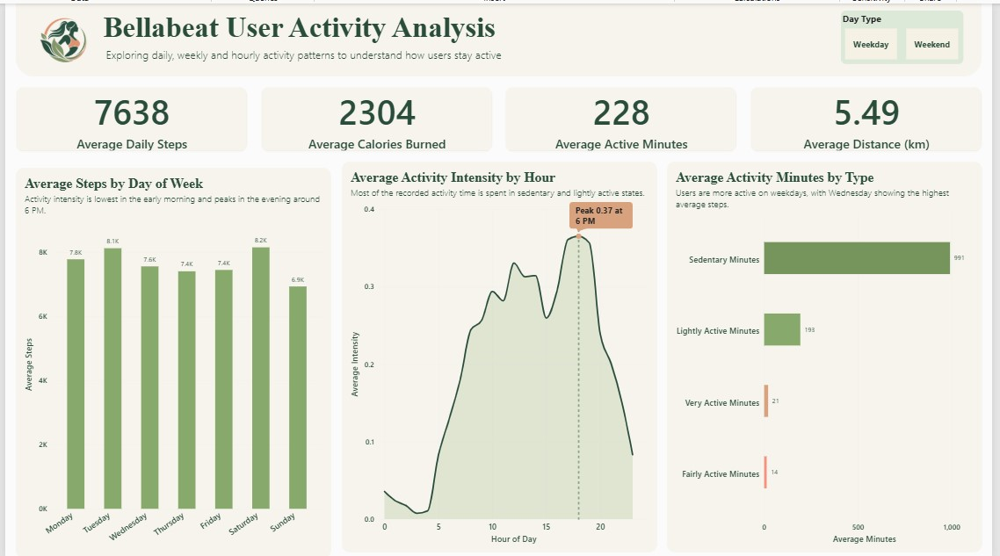
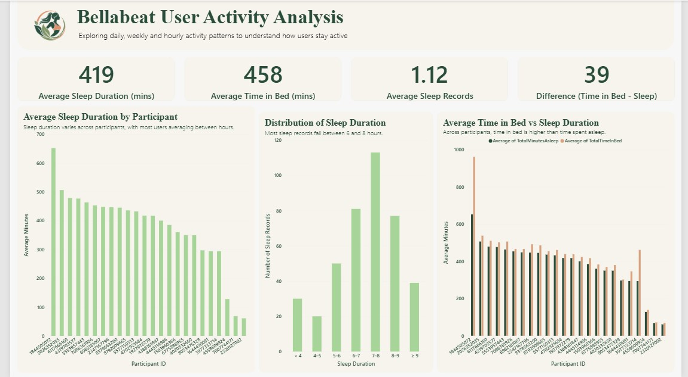

# Fitness Tracker Data Analysis

## Project Overview

This project analyzes fitness tracker data to identify patterns in daily physical activity, hourly activity intensity, and sleep behavior. The goal is to turn raw fitness data into meaningful insights using Excel and Power BI.

The project includes data preparation, exploratory data analysis, and an interactive two-page Power BI dashboard.

## Business Context

This project is based on the Google Data Analytics Capstone case study involving **Bellabeat**, a wellness technology company that develops products designed to support users' health and wellness.

The original business task was to analyze smart-device usage data and identify trends that could help inform marketing strategies for Bellabeat's products.

## Tools and Technologies

- **Microsoft Excel:** Data inspection, cleaning, pivot tables, and exploratory analysis
- **Microsoft Power BI:** Data modeling, DAX measures, interactive visualizations, and dashboard development
- **CSV:** Data storage and preparation

## Datasets

The analysis uses four fitness tracker datasets:

- `dailyActivity_merged.csv` — daily steps, distance, calories, and activity minutes
- `hourlyIntensities_merged.csv` — hourly activity intensity
- `hourlySteps_merged.csv` — hourly step counts
- `sleepDay_merged.csv` — sleep duration and time spent in bed

Analysis-ready versions of these datasets were prepared for the project.

## Project Workflow

1. Imported and inspected the raw CSV datasets.
2. Checked data quality, missing values, duplicate records, and data types.
3. Prepared analysis-ready datasets while retaining valid zero and high activity values.
4. Used Excel pivot tables to explore daily, hourly, and sleep patterns.
5. Imported the prepared datasets into Power BI.
6. Created calculated columns and measures for analysis.
7. Designed a two-page dashboard to communicate the key findings.

## Dashboard

### Page 1: Daily Activity and Intensity

This page explores daily activity and hourly intensity through:

- Average daily steps, calories burned, active minutes, and distance
- Average steps by day of the week
- Average activity intensity by hour
- Average minutes spent in sedentary, light, fairly active, and very active states
- Weekday and weekend filtering

### Page 2: Sleep Analysis

This page explores sleep behavior through:

- Average sleep duration
- Average time spent in bed
- Average sleep records
- Differences between time in bed and time asleep
- Average sleep duration by participant
- Distribution of sleep duration across hourly ranges
- Comparison of average sleep duration and time in bed by participant

## Key Findings

The dashboard highlights several patterns in the analyzed records:

- **Daily activity:** Average daily steps were approximately 7,638, with average calories burned around 2,304.
- **Activity minutes:** The average recorded daily activity was approximately 228 minutes across light, fairly active, and very active categories.
- **Hourly intensity:** Activity intensity was lowest during the early morning and peaked around 6 PM, at approximately 0.37.
- **Day-of-week patterns:** Average steps varied by day, with Saturday showing approximately 8,200 steps and Sunday approximately 6,900 steps.
- **Sleep duration:** Average recorded sleep duration was approximately 419 minutes (7 hours).
- **Time in bed:** Participants spent approximately 458 minutes (7 hours and 38 minutes) in bed on average, about 39 minutes longer than the average time asleep.
- **Sleep distribution:** The 7–8 hour category had the highest number of recorded sleep observations in the prepared dataset.

These results describe the available tracker records and should not be interpreted as universal patterns for all users.

## Limitations

- The dataset represents a limited group of tracker users and a short observation period.
- Activity and sleep datasets do not contain identical participant coverage.
- Differences in recording frequency and missing tracking periods may affect averages.
- The data represents Fitbit device usage rather than Bellabeat product usage, so findings are directional and cannot establish how Bellabeat customers behave.
- Observational patterns do not establish cause and effect.

## Project Objective

This project demonstrates practical skills in data cleaning, exploratory data analysis, Excel pivot tables, Power BI data modeling, DAX, and dashboard design. It also demonstrates how fitness tracker data can be translated into insights that support data-informed business decisions.
